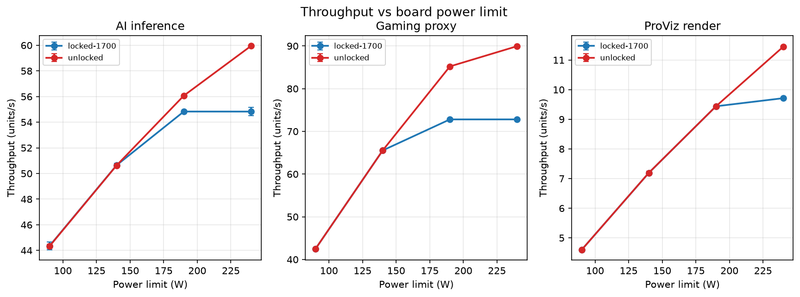
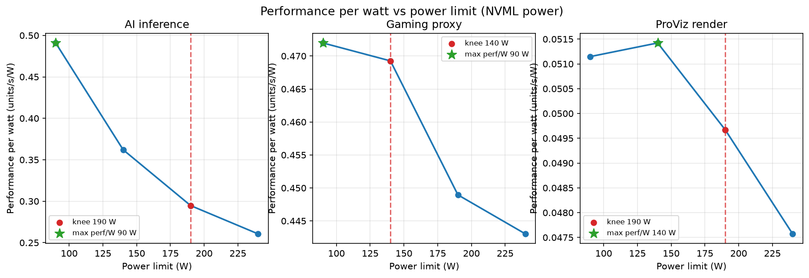
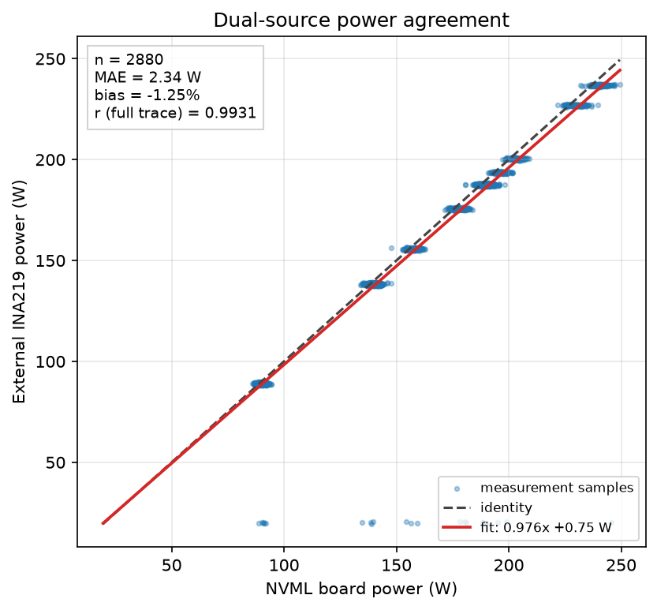
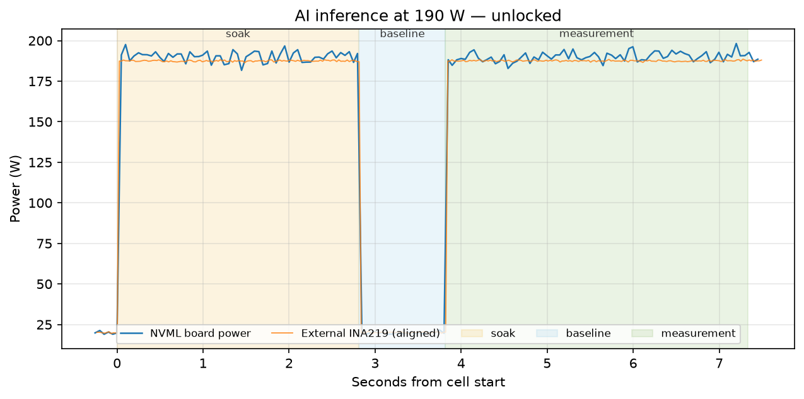
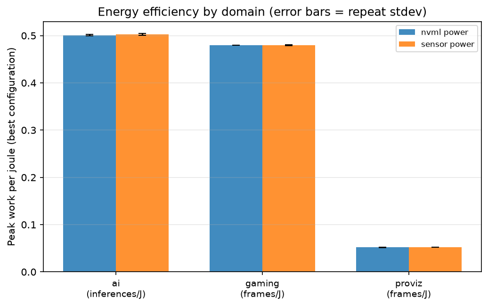

# WattBench

**GPU performance-per-watt measurement with cross-validated software and hardware power sensing.**

WattBench is a post-silicon benchmarking harness. It sweeps GPU board power
limits and clock states, runs a fixed workload matrix across AI inference,
professional rendering, and a gaming-style frame loop, and measures power from
**two independent sources at once**: NVIDIA's onboard telemetry (NVML) and an
external INA219-class shunt sensor read over serial. The two streams are
time-aligned, cross-validated, and turned into work-per-joule curves, an
efficiency knee, and a stakeholder report.

The point is not just to measure frames per second. It is to answer the
question a silicon, platform, or product team actually asks: **how much useful
work does each watt buy, where does the curve stop paying off, and do two
independent power measurements agree well enough to trust the answer?**

> **Measurement source for the results in this README: `synthetic`.**
> This build machine has no NVIDIA GPU and no INA219 attached. Every number
> below was produced by running the real pipeline against WattBench's
> deterministic synthetic backends, which model a first-order thermal soak,
> clock throttling against the power cap, voltage/frequency power scaling,
> per-sample noise, sensor gain error, clock skew, and clock drift. Every
> artifact is stamped `"source": "synthetic"`. The identical pipeline runs
> unchanged on a real rig — set `gpu.mode: hardware` and
> `sensor.mode: hardware`; nothing in the analysis is special-cased.

---

## Results at a glance

Sweep matrix: **8 power/clock configurations x 3 workloads x 2 repeats = 48
measured cells** (24 aggregated cells; 4 power limits x 2 clock states).

| Workload | Peak throughput | Peak board power | Best perf/W | At power limit |
|---|---:|---:|---:|---:|
| AI inference | 59.95 inferences/s | 230.1 W | 0.4909 inferences/s/W | 90 W |
| Gaming proxy | 89.95 frames/s | 203.0 W | 0.4720 frames/s/W | 90 W |
| ProViz render | 11.45 frames/s | 240.6 W | 0.0514 frames/s/W | 140 W |

Efficiency knees (unlocked-clock curve, 90 W–240 W power-limit range):

| Workload | Knee power limit | Throughput at knee | Power at knee | Highest-efficiency point |
|---|---:|---:|---:|---:|
| AI inference | 190 W | **93.5% of peak** | **79.2% of peak power limit** | 0.4909 inferences/s/W at 90 W |
| Gaming proxy | 140 W | **72.9% of peak** | **58.3% of peak power limit** | 0.4720 frames/s/W at 90 W |
| ProViz render | 190 W | **82.5% of peak** | **79.2% of peak power limit** | 0.0514 frames/s/W at 140 W |

Measurement confidence from the same run:

- **48 cells completed, 0 failed, 0 skipped.**
- NVML vs external sensor: **2.34 W mean absolute difference**, **-1.25%
  signed bias**, **Pearson r = 0.9931** over the full aligned trace,
  **95% limits of agreement -6.45 W to +2.58 W**.
- Fitted sensor clock: **-110.5 ms offset** (stdev 10.8 ms) and
  **+164.4 ppm drift** (stdev 578.2 ppm across short 7 s cells; see the note
  on drift below).
- Repeatability: NVML power CV **0.01% / 0.12% / 0.60%** (min/median/max);
  throughput CV **0.00% / 0.01% / 0.08%**.
- Outliers rejected: **0 of 48 repeats**; 0 cells exceeded the 5% sensor-bias
  flag threshold.
- Regression check against a second full sweep: **PASS**, 24/24 cells, largest
  throughput delta **0.037 units/s (0.084%)**.
- Tests: **43 passed**, **73% coverage** (`pytest -q --cov=wattbench`).

The full generated artifacts are committed under
[`runs/20261112T160500Z`](runs/20261112T160500Z) and
[`results/`](results). The second sweep used for the regression verdict is
[`runs/20261112T161300Z`](runs/20261112T161300Z).

---

## Architecture

```
 config/rig.yaml
      │
      ├── GPU backend ────────────────┐   NVML telemetry + nvidia-smi control
      │    (NVML | synthetic)         │
      │                               ▼
      ├── Power-sensor backend ──> runner.sweep()
      │    (serial INA219 | synthetic)   cell = workload × power limit × clock × repeat
      │                                   soak → idle baseline → measurement
      │                                   │
      │                                   ├── raw.csv        (both streams, per sample)
      │                                   └── manifest.json  (provenance, regions, config)
      │                                   │
      │                                   ▼
      │                            analyze
      │                              align: offset + drift + agreement metrics
      │                              stats: mean/median/stdev/CV/95% CI, modified-z outliers
      │                                   │
      │                                   ├── results/results.json  (versioned schema)
      │                                   └── results/cells.csv     (flat table)
      │                                   │
      │                                   ▼
      │                            analysis
      │                              work per joule (trapezoid energy, idle-subtracted too)
      │                              efficiency knee + max perf/W + regression compare
      │                                   │
      │                                   ▼
      └──────────────────────────> plots/*.png + report.md + report.html
```

### Device abstraction

Every hardware touchpoint sits behind a Protocol with a real backend and a
synthetic backend. The factory auto-detects at runtime and stamps the source in
every manifest, cell, and result document.

| Layer | Real backend | Synthetic backend |
|---|---|---|
| GPU telemetry | `NvmlGpu` (pynvml) | `SyntheticGpu` (seeded RNG, thermal ODE, power-cap throttle) |
| GPU control | `nvidia-smi -pl` / `-lgc` / `-rgc`, command logged verbatim | in-process model state |
| Power sensor | `SerialIna219Sensor` (pyserial, `t_ms,bus_v,shunt_mv` lines) | `SyntheticIna219Sensor` (independent skew, drift, gain, noise) |
| Workloads | torch CUDA where available, numpy fallback | same compute, paced by the emulated throttled clock |

The synthetic GPU model uses
`P = P_static + k·(f/f_max)·(V(f)/V_max)²·util`, a first-order thermal equation
`dT/dt = (P − (T−T_amb)/R_th)/C`, a 78 °C thermal throttle, and a binary search
for the highest clock that fits the configured power cap. The synthetic sensor
derives its reading from the modelled rail but adds its own ~180 ppm clock
drift, a 120 ms start skew, a 1.5% gain error, a current offset, and Gaussian
noise. Those imperfections are what the alignment code solves — they are not
cosmetic.

### Artifact layout

```
runs/<run-id>/
  run.json                     matrix, provenance, counts, source
  config.yaml                  exact config used (hash recorded)
  cells/<cell-id>/
    raw.csv                    NVML + sensor samples with region labels
    manifest.json              regions, soak/baseline, workload result, provenance
  results/
    results.json               schema-validated aggregated results
    cells.csv                  one row per aggregated cell
    plots/*.png                five report figures
    report.md / report.html    stakeholder report (HTML self-contained)
results/                       mirror of the latest analyzed run
config/rig.yaml                lab configuration
config/ci_smoke.yaml           fast CI matrix
firmware/ina219_logger.ino     Arduino sketch: t_ms,bus_v,shunt_mv at 100 Hz
docs/rig_setup.md              wiring, shunts, permissions, safety
```

---

## How to run

### Install

```bash
python3.11 -m venv .venv
source .venv/bin/activate
pip install -e ".[dev]"
```

### Discover the active backends

```bash
wattbench devices
```

This prints the GPU backend, name, driver, supported power-limit range, sensor
port status, shunt value, and a clear synthetic/hardware note. On this machine
it reports the synthetic Phoenix X24 emulator and no attached serial port.

### Run a sweep

```bash
wattbench sweep --config config/rig.yaml --out runs/$(date -u +%Y%m%dT%H%M%SZ)
```

The sweep applies each power limit and clock point, soaks the GPU, measures an
idle baseline, runs the workload, writes raw dual-source CSVs, and **always
restores the default power limit and clocks in a `finally` block**. Cells are
randomized and the sweep is resumable: a valid completed cell is skipped, so an
interrupted run can be continued into the same directory.

### Analyze, report, compare

```bash
wattbench analyze runs/<run-id>              # writes results/ and runs/<run-id>/results/
wattbench report  runs/<run-id>              # report.md + self-contained report.html
wattbench report  runs/<run-id> --baseline runs/<other-id>
wattbench compare --baseline runs/<id-a> --candidate runs/<id-b>
```

`analyze` validates the versioned results schema on write and fails loudly on a
violation. `compare` prints a per-cell regression table and exits non-zero on
any FAIL verdict. Exit codes are CI-friendly.

### Point it at a real rig

1. Set `gpu.mode: hardware` and `sensor.mode: hardware` in
   `config/rig.yaml` (explicit hardware never silently falls back).
2. Power-limit and clock changes require root on most systems:

   ```bash
   sudo nvidia-smi -i 0 -pl 200
   sudo nvidia-smi -i 0 -lgc 1700,1700
   sudo nvidia-smi -i 0 -rgc
   ```

   WattBench logs the exact command it invokes. A permission denial raises an
   actionable error rather than leaving you measuring the wrong state.
3. Connect the INA219 logger on the 12 V rail, set the serial port and the
   **measured** shunt resistance, and set `units: mv` for the supplied firmware.
   See [`docs/rig_setup.md`](docs/rig_setup.md) for wiring, safety, and
   permissions.
4. Flash [`firmware/ina219_logger.ino`](firmware/ina219_logger.ino). It prints
   `t_ms,bus_v,shunt_mv` at 100 Hz; malformed lines are counted and skipped.

macOS serial ports look like `/dev/cu.usbserial-*`; Linux usually uses
`/dev/ttyUSB0` (add the user to `dialout`). The sensor is optional: with no port
present, auto mode uses the synthetic sensor and records that fact.

---

## Lab and rig methodology

### Wiring and sense leads

The shunt goes in series with the **12 V PCIe feed**, not the ground return. Use
a four-terminal Kelvin shunt: heavy current path soldered or bolted, sense leads
tapping the shunt body separately and twisted. A 5 mΩ, 5 W shunt drops 100 mV at
20 A and dissipates 2 W, inside the INA219's ±320 mV range. The INA219 is a
26 V-max part; do not use it on a 48 V / 12VHPWR input. Keep USB ground and PSU
ground common, use an isolated USB adapter if earth potentials differ, and never
break a live 12 V rail by hand. Full details and safety notes:
[`docs/rig_setup.md`](docs/rig_setup.md).

### Sampling and alignment

- NVML telemetry at **20 Hz**; external INA219 at **50 Hz** (the firmware runs
  at 100 Hz and the host keeps up; the configured rate is 50 Hz).
- Alignment resamples both streams to a common grid and maximizes normalized
  cross-correlation of the **derivatives**. Raw power is dominated by flat
  plateaus at the cap, where a 100 ms shift is invisible; transitions between
  soak, idle, and load carry the timing information.
- The fitted correction is
  `t_aligned = (t_sensor − t0)/(1 + drift_ppm·1e-6) + t0 + offset_ms·1e6`.
  `drift_ppm` is the sensor clock error (positive = fast). Agreement is
  evaluated in the steady-state measurement window; the Pearson r reported as
  "full trace" includes the transitions and therefore measures tracking rather
  than plateau noise. On short 7 s cells the drift term is at the resolution
  limit; the unit test injects 180 ppm into a 45 s pair and recovers it within
  30 ppm.

### Run control

- **Thermal soak:** each cell runs the workload until the temperature slope over
  the last 2 s falls below 0.05 °C/s or the 2.8 s timeout expires. Soak data is
  discarded.
- **Idle baseline:** measured for 1.0 s before every load run, from both
  sources, and reported both subtracted and unsubtracted in the energy results.
- **Randomized cell order:** seeded shuffle spreads thermal bias across power
  points; the exact order is in `run.json`.
- **Background control:** the top five processes by CPU are captured in every
  manifest at sweep start. The harness does not kill other processes; the
  provenance makes contamination auditable.
- **Repeats:** N=2 in this sweep. Mean, median, sample stdev, CV, and a 95%
  Student-t confidence interval are reported per cell.
- **Outliers:** modified z-score (median/MAD, threshold 3.5). Rejected repeats
  are recorded with their repeat index, value, z-score, and reason — never
  silently dropped. With fewer than three repeats, rejection is disabled.
- **Restore guarantee:** defaults are restored in a `finally` block on normal
  exit and on Ctrl-C.

### Reproducibility checklist

- [ ] Same GPU model, vBIOS, and driver version (recorded in every manifest).
- [ ] Same shunt resistance, measured with a 4-wire meter, and same sense-lead
      placement.
- [ ] Power and clock defaults restored before the next run
      (`nvidia-smi --query-gpu=power.limit,clocks.gr`).
- [ ] Config hash and git commit match the artifacts (`run.json`).
- [ ] Confirmed `source` is `hardware`, not `synthetic`, for a hardware claim.
- [ ] Background load checked against the top-process list in the manifest.
- [ ] Repeats and outlier policy unchanged if comparing across runs.

---

## Measured results

**All figures below were generated by the committed artifacts from
`runs/20261112T160500Z` and `runs/20261112T161300Z` on 2026-11-12.** They come
from the **synthetic** backend, not from silicon. Nothing is hand-entered: the
numbers are copied from `results/results.json`, `results/cells.csv`,
`results/report.md`, and the compare output.

### Sweep and headline numbers

```
Matrix:     8 power/clock configs x 3 workloads x 2 repeats
Measured:   48 cells (24 aggregated), 0 failed, 0 skipped
Duration:   372.7 s
Source:     synthetic
```

| Workload | Peak throughput | Peak board power | Best perf/W | At power limit |
|---|---:|---:|---:|---:|
| AI inference | 59.95 inferences/s | 230.1 W | 0.4909 inferences/s/W | 90 W |
| Gaming proxy | 89.95 frames/s | 203.0 W | 0.4720 frames/s/W | 90 W |
| ProViz render | 11.45 frames/s | 240.6 W | 0.0514 frames/s/W | 140 W |

### Efficiency knee

The knee is the first point where the fitted marginal throughput per added watt
falls below 0.90x its peak marginal return. It is not the same as the
highest-efficiency point: the knee is where additional power stops buying much
throughput; the max perf/W point is where each joule buys the most work.

- **AI inference:** **93.5% of peak throughput at 79.2% of peak power limit**
  (knee at 190 W; 56.1 of 59.95 inferences/s). The highest efficiency is
  0.4909 inferences/s/W at 90 W, which is 73.9% of peak throughput. Moving from
  the knee to the maximum-performance point adds 3.88 inferences/s (+6.9%) for
  39.8 W more board power (+20.9%).
- **Gaming proxy:** **72.9% of peak throughput at 58.3% of peak power limit**
  (knee at 140 W; 65.6 of 89.95 frames/s). The highest efficiency is
  0.4720 frames/s/W at 90 W (47.2% of peak throughput). Going to the peak adds
  24.4 frames/s (+37.3%) for 63.4 W more (+45.4%).
- **ProViz render:** **82.5% of peak throughput at 79.2% of peak power limit**
  (knee at 190 W; 9.44 of 11.45 frames/s). The highest efficiency is
  0.0514 frames/s/W at 140 W (62.8% of peak throughput). Going to the peak adds
  2.01 frames/s (+21.3%) for 50.6 W more (+26.6%).

### Measurement confidence

| Metric | Value |
|---|---|
| NVML vs sensor mean absolute difference | 2.34 W |
| Signed bias (sensor − NVML) | -1.25% |
| Pearson r, full aligned trace | 0.9931 |
| Pearson r, steady-state measurement window | -0.039 |
| Bland-Altman 95% limits of agreement | -6.45 W to +2.58 W |
| Fitted clock offset | -110.5 ms (stdev 10.8 ms) |
| Fitted clock drift | +164.4 ppm (stdev 578.2 ppm) |
| NVML power CV (min / median / max) | 0.01% / 0.12% / 0.60% |
| Throughput CV (min / median / max) | 0.00% / 0.01% / 0.08% |
| Sensor power CV (min / median / max) | 0.00% / 0.18% / 0.45% |
| Repeats rejected as outliers | 0 of 48 |
| Cells over 5% bias flag | 0 |

The steady-state Pearson r is near zero because, once the power cap is holding,
both signals are almost constant and the only remaining variance is independent
measurement noise. That is expected and is exactly why the full-trace r and the
bias/MAE/LoA numbers are reported together. The sensor's 1.5% gain error plus
current offset explains the small negative bias.

The +164 ppm mean drift is close to the +180 ppm injected into the synthetic
sensor, but the per-cell stdev is large: 7 s traces contain only 1.3 ms of
differential drift, below the timing resolution. The estimator behaves as
designed on longer traces — `tests/test_align.py` injects 180 ppm and 120 ms
into a 45 s pair and recovers both within tolerance.

### Regression comparison

The second real sweep (`runs/20261112T161300Z`) was analyzed independently and
compared cell by cell using a tolerance of
`max(3 x combined standard error, 3% of baseline)`, i.e. derived from the
measured repeat stdev, not a hard-coded absolute threshold.

```
overall: PASS (24 cells compared)
largest throughput delta: 0.037 units/s (0.084%)
failing cells: 0
```

The same comparison of a sweep against itself also returns PASS.

### Tests and CI

```
43 passed in 5.27s
TOTAL coverage: 73%
```

GitHub Actions (`.github/workflows/ci.yml`) runs on Python 3.11 and 3.12:
`ruff check .`, the pytest suite with coverage, then a real end-to-end smoke
sweep (`config/ci_smoke.yaml`) through analyze/report/compare, uploading
`results/` as an artifact.

### Generated figures











The per-domain bar chart uses absolute work per joule; the units differ by
domain (inferences/J vs frames/J), so compare bars within a domain, not across
domains.

---

## What the synthetic numbers mean — and what they do not

These results demonstrate the entire measurement and analysis pipeline on a
machine with no GPU and no sensor. The synthetic backends are physically
motivated and produce non-trivial trade-offs (thermal soak, cap-induced clock
throttling, sensor clock drift, gain error, noise), but they are **not a claim
about any real GPU**. A real silicon claim requires `source: hardware` in the
artifacts.

The identical commands, schema, alignment, statistics, knee logic, plots, and
report run against real hardware. The only change is configuration:

```yaml
gpu:    {mode: hardware}
sensor: {mode: hardware, port: /dev/ttyUSB0, shunt_ohms: 0.005, units: mv}
```

If the hardware cannot be opened, explicit hardware mode raises; it never
quietly substitutes a synthetic run.

## Repository map

```
src/wattbench/
  devices/       GpuDevice + NvmlGpu + SyntheticGpu; PowerSensor + serial/synthetic INA219
  workloads/     ai_inference, proviz_render, gaming_proxy
  runner.py      soak, baseline, sampling threads, resumable sweep, provenance
  align.py       offset/drift estimation, MAE/bias/Pearson/Bland-Altman
  stats.py       CV, 95% CI, modified-z outlier rejection
  schema.py      versioned pydantic results schema, validated on write
  analysis.py    work per joule, efficiency knee, regression compare
  plots.py       five matplotlib figures
  report.py      Markdown and self-contained HTML report
config/          rig.yaml, ci_smoke.yaml
docs/            rig_setup.md
firmware/        ina219_logger.ino
tests/           hardware-free unit and end-to-end tests
```
