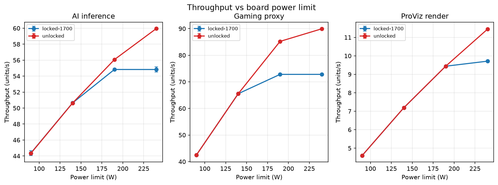
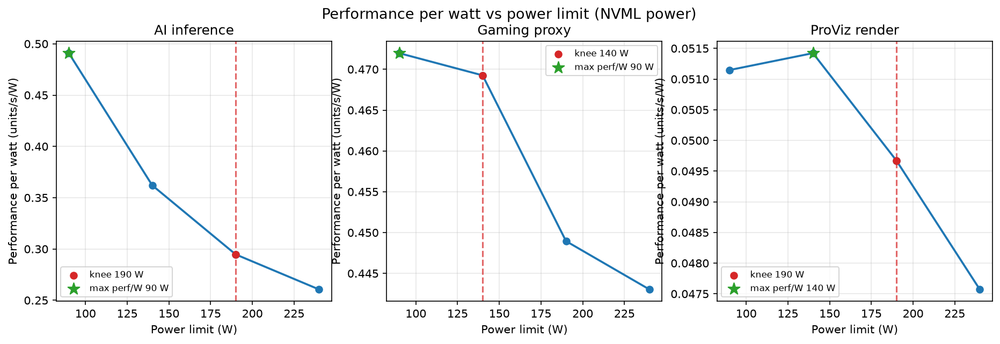
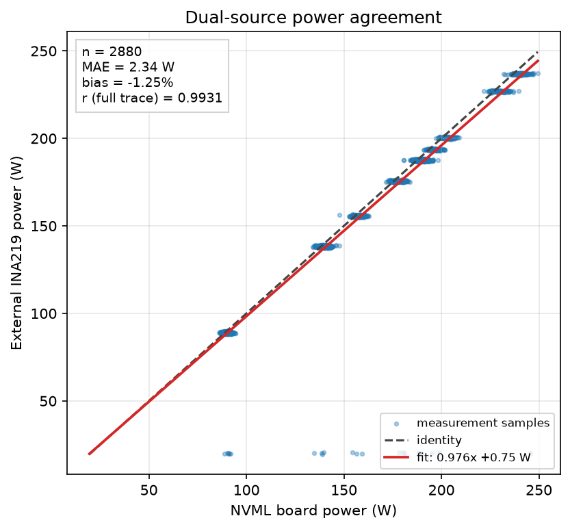
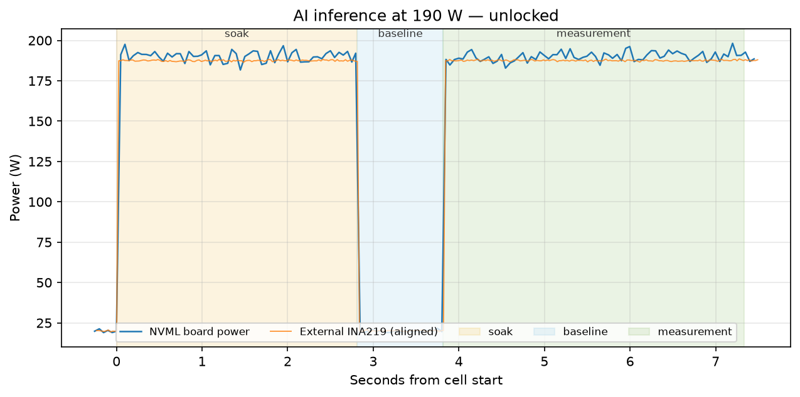
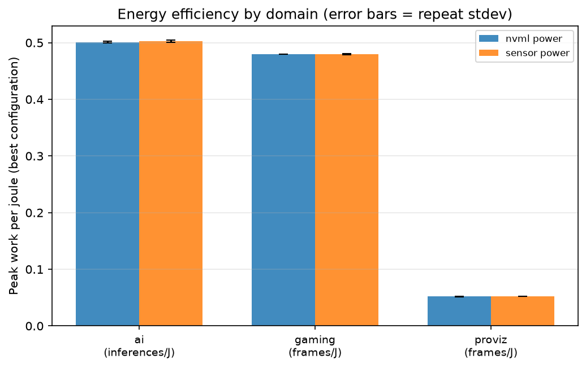

# WattBench report — 20261112T160500Z

**Measurement source: synthetic.** These numbers were produced by WattBench's deterministic synthetic GPU and synthetic INA219 backends. The power model integrates a first-order thermal soak, throttles clocks against the configured board cap, and adds per-sample noise; the sensor stream carries an independent clock skew, drift, gain error and noise. The identical pipeline runs unchanged on a real rig — set `gpu.mode: hardware` and `sensor.mode: hardware`.

Run completed 2026-11-12T15:57:12+00:00 in 372.7 s. Matrix: 8 power/clock configurations x 3 workloads x 2 repeats = 24 aggregated cells (48 measured repeats).

## Headline results

| Workload | Peak throughput | Peak board power | Best perf/W | At power limit | Knee power limit | Knee throughput |
|---|---:|---:|---:|---:|---:|---:|
| AI inference | 59.95 inferences/s | 230.1 W | 0.4909 inferences/s/W | 90 W | 190 W | 93.5% of peak |
| Gaming proxy | 89.95 frames/s | 203.0 W | 0.4720 frames/s/W | 90 W | 140 W | 72.9% of peak |
| ProViz render | 11.45 frames/s | 240.6 W | 0.0514 frames/s/W | 140 W | 190 W | 82.5% of peak |

## Efficiency knee findings

The knee is the first point where the fitted marginal throughput per added watt falls below 0.90x its peak value. It sits between the highest-efficiency point and the maximum-performance point.

**AI inference.** At a 190 W power limit (79.2% of the 240 W tested peak), AI inference delivers 56.07 inferences/s — 93.5% of peak throughput — at 190.3 W measured — 1.18x the throughput per unit of power-limit range relative to the peak setting. The highest measured efficiency is 0.4909 inferences/s/W at 90 W (73.9% of peak throughput). Going from the knee to the maximum-performance point adds 3.88 inferences/s (+6.9%) for 39.8 W more board power (+20.9%).

**Gaming proxy.** At a 140 W power limit (58.3% of the 240 W tested peak), Gaming proxy delivers 65.54 frames/s — 72.9% of peak throughput — at 139.7 W measured — 1.25x the throughput per unit of power-limit range relative to the peak setting. The highest measured efficiency is 0.4720 frames/s/W at 90 W (47.2% of peak throughput). Going from the knee to the maximum-performance point adds 24.42 frames/s (+37.3%) for 63.4 W more board power (+45.4%).

**ProViz render.** At a 190 W power limit (79.2% of the 240 W tested peak), ProViz render delivers 9.44 frames/s — 82.5% of peak throughput — at 190.0 W measured — 1.04x the throughput per unit of power-limit range relative to the peak setting. The highest measured efficiency is 0.0514 frames/s/W at 140 W (62.8% of peak throughput). Going from the knee to the maximum-performance point adds 2.01 frames/s (+21.3%) for 50.6 W more board power (+26.6%).

## Charts











## Measurement confidence

Both power streams were resampled to a common grid and aligned by maximising normalized cross-correlation of their derivatives. Across 24 cells the fitted sensor clock offset is **-110.5 ms** (stdev 10.8 ms) with a fitted drift of **+164.4 ppm** (stdev 578.2 ppm). The drift is a short-window estimate; the synthetic-injection test in `test_align.py` recovers a known drift on a longer trace.

During the steady-state measurement window, NVML and the external sensor agree to a mean absolute difference of **2.34 W**, a signed bias of **-1.25%**, and a full-trace Pearson r of **0.9931**. The 95% Bland-Altman limits of agreement are **-6.45 W to +2.58 W** (sensor minus NVML). No cell exceeded the configured bias threshold.

Run-to-run repeatability: coefficient of variation for NVML power is 0.01% (min) / 0.12% (median) / 0.60% (max); for throughput it is 0.00% / 0.01% / 0.08%. 0 repeat(s) were rejected as modified-z outliers (threshold 3.5); every rejection is listed in `results.json`, not silently dropped. Each cell was measured with 2 usable repeat(s) after rejection.

## Regression check against the baseline run

Overall verdict: **PASS** across 24 matched cells. Tolerance is `max(z x combined standard error, 3.0% of baseline)`, with z = 3.0.

| Cell | Baseline | Candidate | Delta | Tolerance | Verdict |
|---|---:|---:|---:|---:|---:|
| ai_inference__pl090__clk-locked-1700 | 44.306 | 44.344 | +0.037 (+0.08%) | 1.329 | PASS |
| ai_inference__pl090__clk-unlocked | 44.320 | 44.320 | -0.000 (-0.00%) | 1.330 | PASS |
| ai_inference__pl140__clk-locked-1700 | 50.629 | 50.646 | +0.017 (+0.03%) | 1.519 | PASS |
| ai_inference__pl140__clk-unlocked | 50.669 | 50.633 | -0.036 (-0.07%) | 1.520 | PASS |
| ai_inference__pl190__clk-locked-1700 | 54.815 | 54.832 | +0.017 (+0.03%) | 1.644 | PASS |
| ai_inference__pl190__clk-unlocked | 56.057 | 56.070 | +0.013 (+0.02%) | 1.682 | PASS |
| ai_inference__pl240__clk-locked-1700 | 54.831 | 54.829 | -0.002 (-0.00%) | 1.645 | PASS |
| ai_inference__pl240__clk-unlocked | 59.949 | 59.948 | -0.002 (-0.00%) | 1.798 | PASS |
| gaming_proxy__pl090__clk-locked-1700 | 42.493 | 42.487 | -0.006 (-0.02%) | 1.275 | PASS |
| gaming_proxy__pl090__clk-unlocked | 42.494 | 42.491 | -0.003 (-0.01%) | 1.275 | PASS |
| gaming_proxy__pl140__clk-locked-1700 | 65.549 | 65.537 | -0.012 (-0.02%) | 1.966 | PASS |
| gaming_proxy__pl140__clk-unlocked | 65.553 | 65.538 | -0.015 (-0.02%) | 1.967 | PASS |
| gaming_proxy__pl190__clk-locked-1700 | 72.807 | 72.804 | -0.003 (-0.00%) | 2.184 | PASS |
| gaming_proxy__pl190__clk-unlocked | 85.209 | 85.210 | +0.002 (+0.00%) | 2.556 | PASS |
| gaming_proxy__pl240__clk-locked-1700 | 72.829 | 72.808 | -0.021 (-0.03%) | 2.185 | PASS |
| gaming_proxy__pl240__clk-unlocked | 89.960 | 89.955 | -0.005 (-0.01%) | 2.699 | PASS |
| proviz_render__pl090__clk-locked-1700 | 4.595 | 4.595 | +0.000 (+0.00%) | 0.138 | PASS |
| proviz_render__pl090__clk-unlocked | 4.596 | 4.595 | -0.001 (-0.02%) | 0.138 | PASS |
| proviz_render__pl140__clk-locked-1700 | 7.194 | 7.192 | -0.002 (-0.03%) | 0.216 | PASS |
| proviz_render__pl140__clk-unlocked | 7.189 | 7.193 | +0.004 (+0.06%) | 0.216 | PASS |
| proviz_render__pl190__clk-locked-1700 | 9.443 | 9.439 | -0.004 (-0.04%) | 0.283 | PASS |
| proviz_render__pl190__clk-unlocked | 9.439 | 9.439 | -0.000 (-0.00%) | 0.283 | PASS |
| proviz_render__pl240__clk-locked-1700 | 9.711 | 9.712 | +0.001 (+0.01%) | 0.291 | PASS |
| proviz_render__pl240__clk-unlocked | 11.443 | 11.446 | +0.002 (+0.02%) | 0.343 | PASS |

## Rig configuration appendix

```yaml
run:
  name: phoenix-sweep
  seed: 20261112
  out_dir: runs
sampling:
  gpu_hz: 20
  sensor_hz: 50
  align_grid_hz: 20
  bias_threshold_pct: 5.0
gpu:
  mode: auto
  index: 0
  seed: 42
  default_power_limit_w: 250
sensor:
  mode: auto
  port: /dev/ttyUSB0
  baud: 115200
  shunt_ohms: 0.005
  units: mv
  sample_rate_hz: 50
  seed: 7
sweep:
  power_limits_w:
  - 90
  - 140
  - 190
  - 240
  clock_points:
  - min_mhz: 0
    max_mhz: 0
    label: unlocked
  - min_mhz: 1700
    max_mhz: 1700
    label: locked-1700
  repeats: 2
  soak_seconds: 1.8
  soak_timeout_s: 2.8
  soak_slope_c_per_s: 0.05
  idle_baseline_seconds: 1.0
  measure_seconds: 3.5
  randomized: true
  outlier_z: 3.5
  settle_seconds: 0.25
analysis:
  knee_marginal_fraction: 0.9
  regression_z: 3.0
  regression_rel_tol: 0.03
workloads:
- name: ai_inference
  domain: ai
  duration_s: 3.5
- name: proviz_render
  domain: proviz
  duration_s: 3.5
- name: gaming_proxy
  domain: gaming
  duration_s: 3.5
```

## Provenance

- Measurement source: **synthetic**
- GPU: Synthetic Phoenix X24 (emulated) (synthetic backend, driver synthetic-1.0)
- Sensor: synthetic-ina219 on synthetic://ina219, shunt 0.005 Ω
- Host: Abhirams-MacBook-Air.local, macOS-27.2.1-arm64-arm-64bit, 8 CPUs
- Versions: PyYAML 6.0.3, matplotlib 3.11.2, numpy 2.4.6, pandas 3.1.1, pydantic 2.14.3, pynvml 13.0.1, pyserial 3.5, python 3.11.14, wattbench 0.1.0
- Git commit: beaf8e6 (dirty=True)
- Config hash: 149fcf028321490a
- Captured: 2026-11-12T15:50:59+00:00

Top background processes by CPU at sweep start:

```
  50.1%  /opt/homebrew/Cellar/python@3.11/3.11.14_3/Frameworks/Python.framework/Versions/3.11/Resources/Python.app/Contents/MacOS
  37.3%  /System/Library/PrivateFrameworks/SkyLight.framework/Resources/WindowServer
  13.7%  /Applications/Google Chrome.app/Contents/MacOS/Google Chrome
  12.4%  /Users/abhiramkasireddi/Library/Application Support/ai.opencode.desktop/cli/2.2.7-arm64/opencode-cli
   9.0%  /Applications/OpenCode.app/Contents/Frameworks/OpenCode Helper.app/Contents/MacOS/OpenCode Helper
```

## Method notes

- Each sweep cell applies the power limit and clock lock, runs a thermal soak until the temperature slope flattens or the timeout expires, measures an idle baseline, then runs the workload for the configured measurement window.
- Energy is integrated with the trapezoid rule over the sampled power trace, so it reflects the actual power shape rather than a setpoint. Work per joule is reported both with and without idle-power subtraction in `results.json`.
- Cells are executed in randomized order to spread thermal bias, and the sweep is resumable. Repeats are aggregated with mean, median, stdev, CV and a 95% confidence interval; modified-z outliers are recorded, never silently removed.
- The external sensor is aligned to NVML by a fitted constant offset and linear drift; agreement is reported as MAE, percent bias, Pearson r, and Bland-Altman limits.
